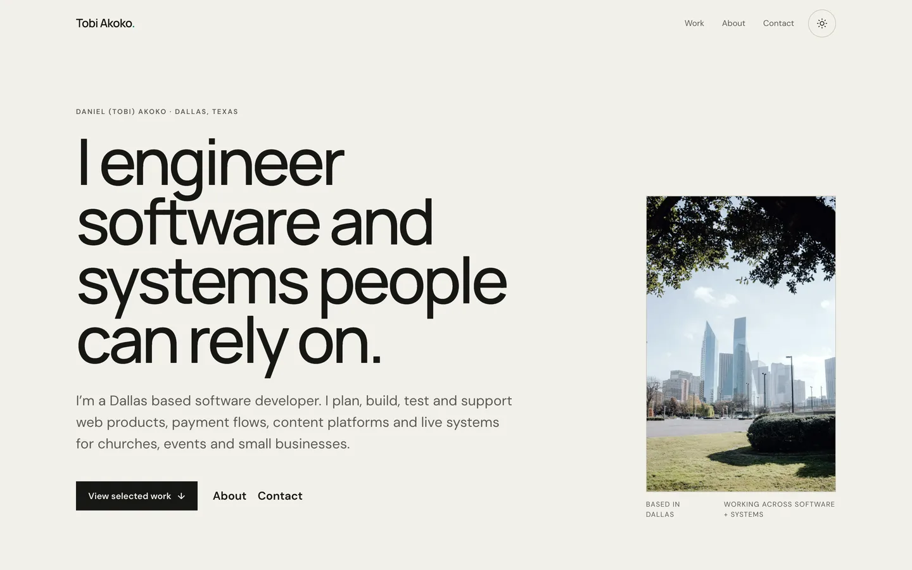

# tobiakoko.com

The portfolio of **Daniel (Tobi) Akoko**, a software engineer in Dallas, Texas.

**Live site:** [tobiakoko.com](https://tobiakoko.com)



## What's on the site

- **Home:** who I am, a short experience strip, selected work, how I can help and my availability.
- **Work:** case studies of real projects: church websites, a talent-competition platform with paid voting, small-business sites, and a church LED wall rebuild. Each has its own page at `/work/<slug>`.
- **About:** background, experience, education and certifications.
- **Contact:** a form that opens a ready-to-send draft in the visitor's own email app, plus my direct address.

Every project image is a real screenshot or diagram. Facts and figures on the site come from a checked source list ([docs/build/CONTENT.md](docs/build/CONTENT.md)), and the build fails if a case study quotes a number that isn't in it.

## Built with

| | |
| --- | --- |
| Framework | [React Router 7](https://reactrouter.com), SPA mode with every route prerendered to HTML |
| UI | React 19, TypeScript (strict) |
| Styling | Tailwind CSS 4, with design tokens as CSS custom properties (light and dark) |
| Fonts | Manrope and DM Sans, self-hosted |
| Content | One markdown file per case study, read and checked at build time |
| Testing | Playwright with axe accessibility checks |
| Hosting | Vercel, with Vercel Analytics |

## How it's made

- **Fast and indexable without a server.** The site runs as a single-page app, but every route is prerendered at build time, so each page ships real HTML with its own title, description and canonical URL. The sitemap is generated from the same route list, so a new case study can't be left out.
- **Content as files.** Each case study is a markdown file in [content/work/](content/work/). Adding one creates its page, its card on Work, its sitemap entry and its previous/next links. The build stops on a missing field, a missing image or an unsourced statistic.
- **One source for every fact.** Name, email, links and availability live in [app/data/site.ts](app/data/site.ts). No component hard-codes them.
- **Accessible by default.** It targets WCAG 2.2 AA: keyboard access everywhere, visible focus, reduced-motion support, real alt text and colours that meet contrast in both themes. Every page is checked with axe in light and dark, with no sideways scroll at 320 px.
- **Light and dark themes** that switch at runtime without a flash on load.
- **Locked-down headers.** A strict Content Security Policy and other security headers are set in [vercel.json](vercel.json).

## Run it locally

Requires Node 20 or later.

```bash
npm install
npm run dev          # http://localhost:5173
```

| Command | What it does |
| --- | --- |
| `npm run dev` | Local dev server; reloads when a case study file changes |
| `npm run build` | Prerendered build in `build/client`, plus `sitemap.xml` |
| `npm run preview` | Serve the production build locally |
| `npm run typecheck` | Route types and TypeScript |
| `npm run lint` | ESLint |
| `npm run test:e2e` | Playwright and axe checks against the build |
| `npm run screenshots` | Recapture project screenshots |
| `npm run images` | Make the smaller image copies and link-preview images |

Before every commit: `npm run typecheck && npm run lint && npm run build`.

## Project structure

```
app/
├── root.tsx            Document shell, theme script, structured data
├── routes.ts           Home, Work, Work detail, About, Contact
├── routes/             One file per page, each with its own meta tags
├── components/         Header, Footer, ProjectCard, CaseStudyHeader, ContactForm, ...
├── data/
│   ├── site.ts         Personal facts and the page meta helper
│   ├── work.ts         Case study types
│   └── work.server.ts  Reads and checks content/work/*.md at build time
└── app.css             Design tokens, fonts and component styles
content/work/           One markdown file per case study
public/work/<slug>/     Screenshots and diagrams for that case study
docs/build/             Content source, design system and build plan
tools/capture-kit/      Screenshot, image and Lighthouse scripts
```

## Deployment

Pushes deploy to Vercel. The build is static files only, with no server bundle. The old `/projects` and `/projects/<slug>` addresses redirect permanently to `/work`.

A [Dockerfile](Dockerfile) is included as an alternative: it builds the site and serves it from nginx as a non-root user.

```bash
docker build -t tobiakoko .
docker run -p 8080:8080 tobiakoko
```

## Contact

[enquiries@tobiakoko.com](mailto:enquiries@tobiakoko.com) · [LinkedIn](https://www.linkedin.com/in/daniel-akoko/) · [GitHub](https://github.com/tobiakoko)
